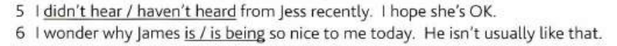
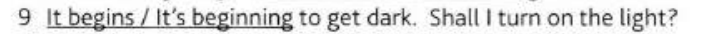
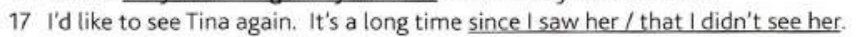

# Grammar-in-Use

## Unit 1-6: Present and Past

## Unit 7-18: Present perfect and past

```
===1. Present continuous
- I am doing
- the action is not finished, middile of doing
- today, this week, this year = period around now
- get change become, increasing

===2. Present simple
- I do
- general, happens all the time, true in general
- how often
- I promise, I apologise, I agree, I suggest

===3. Present continuous and present simple 1
- past---now---future: I am doing
        <--->
- past---now---future: I do
  <------------------>
- temporary situations vs permanent situations

===4. Present continuous and present simple 2
- normal use: like, want, need, prefer, know
- think==believe -> I think
- think==consider - > I am thinking
- see, hear, smell, taste, Look, feel

===5. Past (I did)
- past == point of time

===6. Past contiuous
- I was doing
- The action had already started before this time, but not finished
- (started doing)===(doing)===(finished doing)
- past + past continuous
- When Karen arrived, we were having dinner (we had already started when Karen arrived)
- when Karen arrived, we had dinner. (Karren arrived, and then we had dinner)

===7. Presetn perfect
- I have done
- He has lost his key = He lost it recently, and he still doesn't find it.
- connection with now
- the action in the past has a result now
- I've lost it (=I don't have it now)
- she's gone out (=She is out now)
- Just- a short time
- Already
- Yet = expecting, question or negative sentences
```

#### Example of Unit

```
1. You're working hard today.
2. THe earth goes around the sun.
3. The water is boiling.
3. Water boils at 100 degrees.
4. I want someting to eat.
5. Mozart was an Austrian musiciona and composer.
5. It was cold, so I shut the window.
```

## 

## 



## Unit 19-25: Future
